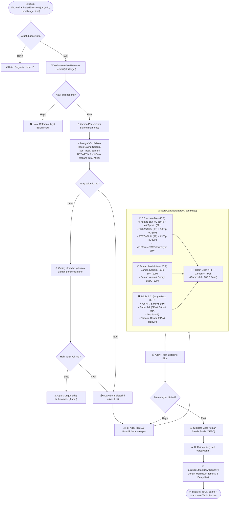

# 📡 RADAR KORELASYON VE 1-TO-N ÇOK KRİTERLİ BENZERLİK DOKTRİNİ
### Taktik Elektronik Harp (EH / SIGINT / ELINT) Karar Destek ve Algoritma Kılavuzu

---

## 1. GENEL BAKIŞ VE OPERASYONEL AMAÇ

Modern Elektronik Harp (EH) ve Muhabere/Radar İstihbaratı (SIGINT/ELINT) operasyonlarında sahadaki algılayıcılardan (KORAL, REDET, Hava/Deniz ED sistemleri) her saniye yüzlerce **Yön Çizgisi (Line of Bearing - LOB)** ve **Kestirim Elipsi** veri tabanına akmaktadır.

Operatörlerin sahada karşılaştığı en kritik 3 operasyonel problem şunlardır:
1. **Başıboş LOB Füzyonu:** Farklı istasyonların aynı anda yakaladığı ama henüz bir kestirime bağlanmamış LOB'ların aynı hedefe mi ait olduğunun tespiti.
2. **Frekans Atlayan / Mod Değiştiren Hedeflerin İz Takibi (Track Association):** Bir düşman radarının (örneğin *92N6E Grave Stone*) sabit frekanstan çevik (agile) veya darbe sıkıştırmalı (chirp) moda geçtiğinde aynı hedef olarak ilişkilendirilmesi.
3. **Mükerrer Hedef Ayıklama:** Farklı sensörlerin aynı radar sistemine farklı zamanlarda verdiği mükerrer kayıtların korelasyonu.

Bu dokümanda, sistemde geliştirilen **Bire Bir (1-to-1) Karşılaştırma** ve **1-to-N Çok Kriterli Benzerlik Motoru** algoritmalarının matematiksel temelleri, puanlama matrisi, akış şemaları ve sayısal örnekleri ayrıntılı olarak açıklanmaktadır.

---

## 2. BİRE BİR (1-TO-1) RADAR KARŞILAŞTIRMA MATEMATİĞİ

İki radar emisyon kaydı ($R_1$ ve $R_2$) karşılaştırılırken sayısal parametreler (Zaman, Frekans, PRI, PW, ATP) **1D Jaccard İndeksi (Intersection over Union - IoU)** ile, metinsel/kategorik parametreler ise **bire bir aynılık** üzerinden değerlendirilir.

### 2.1. Sayısal Aralık Uyum Oranı (1D IoU Formülü)

İki sürekli aralık $A = [A_{\min}, A_{\max}]$ ve $B = [B_{\min}, B_{\max}]$ için:

$$\text{Kesişim Uzunluğu (Intersection)} = \max\left(0.0, \; \min(A_{\max}, B_{\max}) - \max(A_{\min}, B_{\min})\right)$$

$$\text{Birleşim Uzunluğu (Union)} = \max(A_{\max}, B_{\max}) - \min(A_{\min}, B_{\min})$$

$$\text{Uyum Oranı (IoU)} = \frac{\text{Intersection}}{\text{Union}} \quad (0.0 \le \text{IoU} \le 1.0)$$

---

### 2.2. Sıfır Genişlikli Nokta Değerler ($\min == \max$) ve Teğet Durumları

Sayısal değerlerde sıfıra bölme hatasını ($NaN$ / $\infty$) engellemek ve taktik doğruluğu sağlamak için 3 özel durum işletilir:

```
Durum 1: İki Değer de Tekil Nokta (aMin == aMax && bMin == bMax)
  │─── |aMin - bMin| <= 1e-4 ise ──────────> %100 Uyum (IoU = 1.0, Gap = null)
  └─── Fark varsa (|aMin - bMin| > 1e-4) ──> %0 Uyum (IoU = 0.0, Gap = |aMin - bMin|)

Durum 2: Biri Tekil Nokta, Diğeri Aralık (Örn: aMin == aMax, [bMin - bMax])
  │─── Nokta aralığın İÇİNDE ise ──────────> %100 Kapsama Uyumu (IoU = 1.0, Gap = null)
  └─── Nokta aralığın DIŞINDA ise ─────────> %0 Uyum (Gap = Aralığa en yakın mesafe)

Durum 3: Standart İki Aralık ([aMin, aMax] ve [bMin, bMax])
  │─── Kesişim > 0 ise ────────────────────> IoU = Intersection / Union
  │─── Teğet Temas (aMax == bMin) ─────────> Sınırda Temas (Intersection = 0, Gap = 0.0)
  └─── Ayrık Aralıklar (Kesişim <= 0) ─────> %0 Uyum (Gap = max(aMin, bMin) - min(aMax, bMax))
```

---

### 2.3. Zaman Uyumu ve Zaman Yakınlığı Ayrımı

Zaman analizinde iki farklı fiziksel durum oluşabilir:

1. **Eşzamanlı Çakışma (Overlap):**
   - $\text{Kesişim Süresi} > 0 \implies \text{Zaman Uyum Oranı} = \frac{\text{Kesişim Süresi}}{\text{Birleşim Süresi}} \times 100$
   - *Örnek:* İki algılayıcı aynı anda yayını yakalamıştır.
2. **Ayrık Yayınlar (No Overlap):**
   - İki yayın farklı zaman dilimlerindedir. Bu durumda **Zaman Yakınlığı (Gap Süresi)** hesaplanır:
   $$\text{Zaman Farkı} = \max(\text{Start}_1, \text{Start}_2) - \min(\text{End}_1, \text{End}_2)$$
   - Bu fark operatöre okunaklı olarak `X saat Y dakika Z saniye` cinsinden raporlanır.

---

### 2.4. Çoklu Alt Tip Listeleri (Frekans, PRI, PW, ATP Modları)

Radarlar tek bir sabit frekansta çalışabileceği gibi çoklu çalışma modlarına da (SABIT, AGILE, CHIRP, STAGGERED) sahip olabilir.
- Radar kayıtlarındaki `frekansListesiJson`, `priListesiJson`, `pwListesiJson` ayrıştırılır.
- Her iki radarda da mevcut olan **ortak mod tipleri** (`SABIT`, `AGILE` vb.) tespit edilir.
- Ortak her mod tipi için kendi alt aralıkları üzerinden bağımsız IoU hesaplanır:
  $$\text{Alt Tip IoU} = \frac{\text{Intersection}_{\text{tip}}}{\text{Union}_{\text{tip}}}$$

---

## 3. 1-TO-N ÇOK KRİTERLİ BENZERLİK VE KORELASYON MOTORU

Operatör sahada tek bir radar kaydı seçtiğinde (`targetId`), sistem belirli bir zaman penceresinde (`timeRange`) bu radara en çok benzeyen ilk $N$ radar kaydını bulmak için **100 Puanlık Çok Kriterli Puanlama Matrisi**'ni çalıştırır.

### 3.1. $O(N^2)$ Karmaşıklığının Aşılması (SQL Index Gating)

1.000.000+ kayıtlık veritabanında her kaydı birbiriyle kıyaslamak imkansızdır ($5.000 \times 4.999 / 2 \approx 12.5\text{ M}$ işlem). Bu nedenle **2 Aşamalı Coarse-to-Fine Pipeline** uygulanır:

```
[1.000.000+ Kayıtlık Havuz]
          │
          ▼  AŞAMA 1: PostgreSQL B-Tree Index Gating (Milisaniyeler içinde)
             • Zaman Filtresi: [targetTime - X saat, targetTime + X saat]
             • Frekans Kapısı: targetFrekans ± 300 MHz
          │
          ▼  (Aday havuzu 50 - 500 kayda düşürülür)
          │
          ▼  AŞAMA 2: 100 Puanlık Hassas Çok Kriterli Matris (Java Engine)
             • RF İmzası (%45) + Zaman (%20) + Taktik/Coğrafya (%35)
          │
          ▼  AŞAMA 3: Skora Göre Azalan Sıralama (DESC) ve Top-K Seçimi
[Operatöre Zengin Markdown Tablosu + Detay Puan Kartı]
```

---

### 3.2. 100 Puanlık Nihai Puanlama Matrisi

Her bir aday için toplam benzerlik skoru $S_{\text{toplam}} \in [0.0, 100.0]$ puan aralığında hesaplanır:

| Kategori | Parametre / Kriter | Ağırlık | Hesaplama Mantığı | Null/Eksik Durumu |
| :--- | :--- | :---: | :--- | :---: |
| **A. RF Sinyal İmzası**<br>*(Toplam: 45 Puan)* | **1. Frekans Zarfı** | **10 P** | Zarf $\text{IoU} \times 10.0$ | **0 P** |
| | **2. Frekans Alt Tipleri** | **8 P** | En az bir tip ortaksa, ortak tiplerin ortalama $\text{IoU} \times 8.0$ | **0 P** |
| | **3. PRI Zarfı** | **8 P** | Zarf $\text{IoU} \times 8.0$ | **0 P** |
| | **4. PRI Alt Tipleri** | **6 P** | Ortak tiplerin ortalama $\text{IoU} \times 6.0$ | **0 P** |
| | **5. PW (Darbe) Zarfı** | **5 P** | Zarf $\text{IoU} \times 5.0$ | **0 P** |
| | **6. PW Alt Tipleri** | **3 P** | Ortak tiplerin ortalama $\text{IoU} \times 3.0$ | **0 P** |
| | **7. RF Modülasyon / Dalga** | **5 P** | • Modülasyon (MOP) Bire bir: **2 P**<br>• Pulse / CW Bire bir: **2 P**<br>• Polarizasyon Bire bir: **1 P** | **0 P** |
| **B. Zaman Analizi**<br>*(Toplam: 20 Puan - Eşit Seviye)* | **8. Zaman Kesişim Uyumu** | **10 P** | • Eşzamanlı aktiflik varsa: $\text{IoU} \times 10.0$<br>• Çakışma yoksa (Ayrık): **0 P** | **0 P** |
| | **9. Zaman Yakınlığı** | **10 P** | • Eşzamanlı aktif ise (fark = 0): **10 P**<br>• Ayrık ise süre farkına göre:<br>&nbsp;&nbsp;$\le 5\text{ dk}$: **9 P**<br>&nbsp;&nbsp;$\le 30\text{ dk}$: **7 P**<br>&nbsp;&nbsp;$\le 2\text{ sa}$: **5 P**<br>&nbsp;&nbsp;$\le 6\text{ sa}$: **3 P**<br>&nbsp;&nbsp;$\le 24\text{ sa}$: **1 P**<br>&nbsp;&nbsp;$> 24\text{ sa}$: **0 P** | **0 P** |
| **C. Coğrafya ve Taktik Bilgiler**<br>*(Toplam: 35 Puan)* | **10. Hedef Yer Bilgisi** | **6 P** | Bire bir aynı coğrafi yer metni: **6 P** | **0 P** |
| | **11. Hedef Mevzi Bilgisi** | **4 P** | Bire bir aynı mevzi metni: **4 P** | **0 P** |
| | **12. Radar Adı** | **8 P** | Bire bir aynı model/isim: **8 P** | **0 P** |
| | **13. Radar Görevi** | **4 P** | Bire bir aynı operasyonel görev: **4 P** | **0 P** |
| | **14. Teşhis (Kimlik)** | **8 P** | Bire bir aynı kimlik (`DUSMAN == DUSMAN`): **8 P** | **0 P** |
| | **15. Platform Ortamı** | **3 P** | Bire bir aynı ortam (`KARA == KARA`): **3 P** | **0 P** |
| | **16. Platform Tipi** | **2 P** | Bire bir aynı taşıyıcı tipi: **2 P** | **0 P** |
| **GENEL TOPLAM** | | **100 Puan** | **Benzerlik Oranı: %0.0 - %100.0** | |

> [!IMPORTANT]
> **Eksik Veri Prensibi:** Doktrin kararı gereği; eksik, girilmemiş veya `null` olan tüm özellikler cezalandırılır ve **0 Puan** alır. Böylece belirsiz veya eksik veri içeren kayıtlar, doğrulanmış ve tam kayıtlardan daha yüksek skora ulaşamaz.

---

### 3.3. Gelecek Değerlendirmeler & Beklemedeki Parametreler (TODO / Yol Haritası)

Operatör ve komuta katı kararıyla şimdilik 1-to-N benzerlik motoruna dahil edilmeyen, **ilerleyen aşamalarda tekrar değerlendirilmek üzere "TODO" olarak kayıt altına alınan** parametreler ve gerekçeleri aşağıdadır:

#### 1. ATP (Anten Tarama Periyodu) Zarfı ve Alt Tipleri
- **Mevcut Durum:** 1-to-1 karşılaştırmasında tam olarak aktiftir (Zarf IoU ve Alt Tip IoU hesaplanır).
- **1-to-N'de Bekletilme Gerekçesi:** "Eksik / Null Veri = 0 Puan" prensibi geçerlidir. Sahada hedef izleme (tracking / lock-on) modunda sabit duran veya anten tur süresi henüz ESM/ELINT sensörlerince ölçülememiş radarların haksız yere 0 puan alarak, frekans/PRI/PW imzaları bire bir uyuşmasına rağmen benzerlik sıralamasında haksızca geriye düşmesini engellemek için şimdilik devre dışı bırakılmıştır.
- **İlerideki Değerlendirme:** Sensör kapsama kalitesi arttığında veya ATP varlığına göre dinamik normalizasyon opsiyonu eklendiğinde RF kategorisine (örn. 5 Puan olarak) dahil edilecektir.

#### 2. ELNOT (`elintNotasyonu`)
- **Tanım:** NATO ve Milli ELINT veritabanlarında radar sistemlerine tahsis edilen standart 5 karakterli/kodlu sinyal tanımlayıcısı (Örn: `EL-3401`, `R-12B`).
- **Değerlendirme Notu:** Bire bir eşleşme durumunda taktik kategoriye doğrudan güçlü bir teşhis teyidi olarak 3 - 5 puanlık katkı sağlayabilir.

#### 3. Spot No (`spotNo`)
- **Tanım:** Radar sisteminin önceden planlanmış operasyonel frekans kanalı / spot frekans indeks numarası (Örn: `SPOT-04`).
- **Değerlendirme Notu:** Özellikle frekans atlamalı (frequency agile) veya kanalize çalışan tehdit radarlarında aynı kanalda çalışma benzerliği için 2 - 3 puanlık bir ağırlıkla değerlendirilebilir.

#### 4. HSS (`hss`) Entegrasyonu
- **Tanım:** Radarın bir Hava Savunma Sistemi (HSS) bataryasına (Örn: S-300, Patriot, HİSAR) veya komuta kontrol mimarisine bağlı olup olmadığı bilgisi.
- **Değerlendirme Notu:** Taktik durumsal farkındalıkta hedef angajman önceliğini doğrudan etkileyen bir parametredir.

#### 5. Önerilen Gelecek 100 Puan Dağılım Modeli (Revizyon Taslağı)

Bu parametrelerin tamamı veya bir kısmı devreye alındığında 100 puanlık skalanın korunması için önerilen denge matrisi:

| Ana Kategori | Parametreler | Önerilen Ağırlık | Açıklama |
| :--- | :--- | :---: | :--- |
| **A. RF Sinyal İmzası** | Frekans (16P) + PRI (12P) + PW (8P) + Modülasyon (4P) + **ATP (5P)** | **45 Puan** | ATP dahil edilerek RF sinyal imzası tamamlanır. |
| **B. Zaman Analizi** | Zaman Kesişimi (10P) + Zaman Yakınlığı (10P) | **20 Puan** | Eşit ağırlıklı bağımsız zaman ekseni aynen korunur. |
| **C. Taktik, Teşhis & Coğrafya** | Yer/Mevzi (10P) + Radar Adı/Görevi (10P) + Teşhis (7P) + **ELNOT / Spot / HSS (5P)** + Platform (3P) | **35 Puan** | ELNOT, Spot No ve HSS taktik kimlik doğrulamasına eklenir. |
| **GENEL TOPLAM** | | **100 Puan** | **%100 üzerinden dengeli ve tam kapsamlı ELINT doktrini.** |

---

## 4. KAPSAMLI ALGORİTMA AKIŞ ŞEMASI



---

## 5. SOMUT SAYISAL ÖRNEK VE ADIM ADIM PUAN HESAPLAMA SENARYOSU

### 5.1. Senaryo Verileri

**Referans Hedef (`REF-92N6E`):**
- **Zaman:** `18.10.2026 14:00:00 - 14:05:00` (300 sn süre)
- **Frekans:** `9200.0 - 9280.0 MHz` | Alt Tipler: `[SABIT: 9200 - 9280]`
- **PRI:** `750.0 - 850.0 µs` | Alt Tipler: `[SABIT: 750 - 850]`
- **PW:** `2.0 - 3.0 µs` | Alt Tipler: `[SABIT: 2.0 - 3.0]`
- **Modülasyon:** `P_MOP` | **Pulse/CW:** `PULSE` | **Polarizasyon:** `DIKEY`
- **Taktik Yer:** `Doğu Akdeniz / Kıbrıs Kuzeyi` | **Mevzi:** `Mevzi-A`
- **Radar Adı:** `92N6E Grave Stone` | **Radar Görevi:** `Atış Kontrol`
- **Teşhis:** `DUSMAN` | **Platform:** `KARA` / `BATARYA`

---

### 5.2. Aday 1: Çok Yüksek Benzerlikli Eşzamanlı LOB (`CANDIDATE-LOB-1`)

**Aday 1 Parametreleri:**
- **Zaman:** `18.10.2026 14:02:00 - 14:05:00` (Eşzamanlı: Kesişim = 180 sn, Birleşim = 300 sn $\implies \text{IoU} = 0.60$)
- **Frekans:** `9220.0 - 9280.0 MHz` (Kesişim = 60, Birleşim = 80 $\implies \text{IoU} = 0.75$) | Alt Tip: `SABIT: 0.75 IoU`
- **PRI:** `760.0 - 850.0 µs` (Kesişim = 90, Birleşim = 100 $\implies \text{IoU} = 0.90$) | Alt Tip: `SABIT: 0.90 IoU`
- **PW:** `2.2 - 3.0 µs` (Kesişim = 0.8, Birleşim = 1.0 $\implies \text{IoU} = 0.80$) | Alt Tip: `SABIT: 0.80 IoU`
- **MOP:** `P_MOP` (Aynı) | **Pulse/CW:** `PULSE` (Aynı) | **Polarizasyon:** `null` (Eksik)
- **Yer:** `Doğu Akdeniz / Kıbrıs Kuzeyi` (Aynı) | **Mevzi:** `null` (Eksik)
- **Radar Adı:** `92N6E Grave Stone` (Aynı) | **Radar Görevi:** `Atış Kontrol` (Aynı)
- **Teşhis:** `DUSMAN` (Aynı) | **Platform:** `KARA` (Aynı) / `BATARYA` (Aynı)

#### Aday 1 Adım Adım Puan Hesabı:

```
1. RF Sinyal İmzası Puanı (Max 45 P):
   • Frekans Zarfı: 0.75 x 10.0 P  = 7.5 P
   • Frekans Alt Tip: 0.75 x 8.0 P = 6.0 P
   • PRI Zarfı: 0.90 x 8.0 P       = 7.2 P
   • PRI Alt Tip: 0.90 x 6.0 P     = 5.4 P
   • PW Zarfı: 0.80 x 5.0 P        = 4.0 P
   • PW Alt Tip: 0.80 x 3.0 P      = 2.4 P
   • MOP Bire bir:                 = 2.0 P
   • Pulse/CW Bire bir:            = 2.0 P
   • Polarizasyon (null):          = 0.0 P (Cezalandırıldı)
   ──> RF Toplam Puanı             = 36.5 / 45.0 Puan

2. Zaman Analizi Puanı (Max 20 P):
   • Zaman Kesişim IoU: 0.60 x 10.0 P = 6.0 P
   • Zaman Yakınlığı (Eşzamanlı aktif) = 10.0 P
   ──> Zaman Toplam Puanı             = 16.0 / 20.0 Puan

3. Coğrafya ve Taktik Bilgiler Puanı (Max 35 P):
   • Hedef Yer Bilgisi (Aynı):      = 6.0 P
   • Hedef Mevzi Bilgisi (null):    = 0.0 P (Cezalandırıldı)
   • Radar Adı (Aynı):              = 8.0 P
   • Radar Görevi (Aynı):           = 4.0 P
   • Teşhis (DUSMAN == DUSMAN):     = 8.0 P
   • Platform Ortamı (KARA == KARA): = 3.0 P
   • Platform Tipi (BATARYA == BATARYA): = 2.0 P
   ──> Taktik Toplam Puanı          = 31.0 / 35.0 Puan

═══════════════════════════════════════════════════════
TOPLAM BENZERLİK SKORU: 36.5 + 16.0 + 31.0 = 83.5 / 100 Puan (%83.5)
Taktik Sonuç: ÇOK YÜKSEK BENZERLİK (Aynı hedefe ait çoklu LOB kestirimi)
═══════════════════════════════════════════════════════
```

---

### 5.3. Aday 2: Ayrık Zamanlı ve Kısmi Farklı Radar (`CANDIDATE-LOB-2`)

**Aday 2 Parametreleri:**
- **Zaman:** `18.10.2026 14:20:00 - 14:25:00` (Ayrık, Kesişim = 0, Zaman Farkı = 15 dakika)
- **Frekans:** `9200.0 - 9260.0 MHz` ($\text{IoU} = 0.75$) | Alt Tip: `SABIT: 0.75 IoU`
- **PRI:** `750.0 - 800.0 µs` ($\text{IoU} = 0.50$) | Alt Tip: `SABIT: 0.50 IoU`
- **PW:** `null` (Eksik)
- **MOP:** `F_MOP` (Farklı!) | **Pulse/CW:** `PULSE` (Aynı)
- **Yer:** `Ege Denizi` (Farklı sektör)
- **Radar Adı:** `92N6E Grave Stone` (Aynı) | **Teşhis:** `DUSMAN` (Aynı)

#### Aday 2 Adım Adım Puan Hesabı:

```
1. RF Sinyal İmzası Puanı (Max 45 P):
   • Frekans Zarfı (0.75 x 10):    = 7.5 P
   • Frekans Alt Tip (0.75 x 8):   = 6.0 P
   • PRI Zarfı (0.50 x 8):         = 4.0 P
   • PRI Alt Tip (0.50 x 6):       = 3.0 P
   • PW Zarfı (null):              = 0.0 P
   • PW Alt Tip (null):            = 0.0 P
   • MOP (Farklı modülasyon):      = 0.0 P
   • Pulse/CW (Aynı):              = 2.0 P
   • Polarizasyon (null):          = 0.0 P
   ──> RF Toplam Puanı             = 22.5 / 45.0 Puan

2. Zaman Analizi Puanı (Max 20 P):
   • Zaman Kesişim IoU (Çakışma yok): = 0.0 P
   • Zaman Yakınlığı (Fark = 15 dk <= 30 dk): = 7.0 P
   ──> Zaman Toplam Puanı             = 7.0 / 20.0 Puan

3. Coğrafya ve Taktik Bilgiler Puanı (Max 35 P):
   • Hedef Yer (Farklı sektör):    = 0.0 P
   • Hedef Mevzi (null):           = 0.0 P
   • Radar Adı (Aynı):             = 8.0 P
   • Radar Görevi (Aynı):          = 4.0 P
   • Teşhis (Aynı):                = 8.0 P
   • Platform Ortamı / Tipi:       = 0.0 P
   ──> Taktik Toplam Puanı         = 20.0 / 35.0 Puan

═══════════════════════════════════════════════════════
TOPLAM BENZERLİK SKORU: 22.5 + 7.0 + 20.0 = 49.5 / 100 Puan (%49.5)
Taktik Sonuç: ORTA / KISMİ BENZERLİK (Aynı sistem tipi ancak farklı intikal/mevzi)
═══════════════════════════════════════════════════════
```

---

## 6. YAZILIM MİMARİSİ VE ENTEGRASYON KILAVUZU

### 6.1. Bileşen Sorumlulukları

| Bileşen | Dosya Yolu | Sorumluluğu |
| :--- | :--- | :--- |
| **`RadarCorrelationService`** | `com.c2.ew.agent.service.RadarCorrelationService` | Matematiksel IoU motoru, 1-to-1 karşılaştırma, PostgreSQL indeksli aday sorgusu, 100 puanlık skorlama ve Markdown tablo üretim motoru. |
| **`RadarEmissionTools`** | `com.c2.ew.agent.tools.RadarEmissionTools` | Spring AI `@Tool` anotasyonlu ajan araçları (`compareRadarEmissions`, `findSimilarRadarEmissions`). |
| **`TacticalController`** | `com.c2.ew.web.TacticalController` | İstemciler ve dış sistemler için REST API uç noktaları (`/api/v1/tactical/emissions/compare`, `/api/v1/tactical/emissions/{id}/similar`). |
| **`TacticalAgentService`** | `com.c2.ew.agent.service.TacticalAgentService` | AI Copilot sistem direktifi, operatör doğal dil isteklerini doğru araçlara bağlama. |

---

### 6.2. REST API Kullanım Referansı

#### 1. İki Radarı Bire Bir Karşılaştırma (1-to-1)
```http
GET /api/v1/tactical/emissions/compare?id1=EMI-1001&id2=EMI-1003
```
**Dönen JSON Alanları:**
- `durum`: `"BASARILI"`
- `zamanUyumu`: `{ hasOverlap: true, matchRatio: 0.76, gapDistance: null }`
- `frekansZarfUyumu`: `{ hasOverlap: true, matchRatio: 0.64 }`
- `frekansAltTipler`: `[ { tip: "SABIT", tipOrtak: true, matchRatio: 0.64 } ]`
- `kategorikUyum`: `{ teshisUyumlu: true, radarAdiUyumlu: true, yerUyumlu: false ... }`
- `markdownRaporu`: Hazır formatlanmış zengin Markdown değerlendirme tablosu.

#### 2. En Çok Benzeyenleri Arama (1-to-N Top-K)
```http
GET /api/v1/tactical/emissions/EMI-LIVE-53BB9E1F/similar?timeRange=SON_24_SAAT&limit=5
```
**Desteklenen `timeRange` Parametreleri:**
- `SON_1_SAAT`: Referans zamanın $\pm 1$ saat penceresi
- `SON_6_SAAT`: Referans zamanın $\pm 6$ saat penceresi
- `SON_24_SAAT` (Varsayılan): Referans zamanın $\pm 24$ saat penceresi
- `SON_7_GUN`: Referans zamanın $\pm 7$ gün penceresi
- `ALL`: Tüm veri tabanında (zaman kısıtı olmadan) arama

---

### 6.3. AI Copilot Doğal Dil Sorgu Örnekleri

Operatör taktik sohbet arayüzünden aşağıdaki gibi doğal dil sorguları yönelttiğinde Spring AI ilgili araçları çağırır:

- *"EMI-1001 ile EMI-1003 radarlarını karşılaştır, uyum oranları nedir?"*  
  $\implies$ [`compareRadarEmissions`](file:///c:/Users/onderproje/Desktop/AntigravitySpringAIDeneme3/src/main/java/com/c2/ew/agent/tools/RadarEmissionTools.java#L624-L633) çağrılır.
- *"Bu iki LOB aynı radara mı ait, teşhis ve frekansları tutuyor mu?"*  
  $\implies$ [`compareRadarLobs`](file:///c:/Users/onderproje/Desktop/AntigravitySpringAIDeneme3/src/main/java/com/c2/ew/agent/tools/RadarEmissionTools.java#L630-L633) çağrılır.
- *"EMI-LIVE-53BB9E1F radarına son 24 saatte en çok benzeyen 5 radar kaydını getir."*  
  $\implies$ [`findSimilarRadarEmissions`](file:///c:/Users/onderproje/Desktop/AntigravitySpringAIDeneme3/src/main/java/com/c2/ew/agent/tools/RadarEmissionTools.java#L635-L650) çağrılır.
- *"Sahada bu hedefin RF parmak izine uyan başka temaslar var mı?"*  
  $\implies$ [`findSimilarRadarEmissions`](file:///c:/Users/onderproje/Desktop/AntigravitySpringAIDeneme3/src/main/java/com/c2/ew/agent/tools/RadarEmissionTools.java#L635-L650) çağrılır.

---

## 7. ÖZET VE SONUÇ

Bu doktrinel ve algoritmik yapı sayesinde sistem:
1. İki radar kaydı arasında **fiziksel, zamansal ve taktiksel korelasyonu** nesnel bir tabloyla sunar.
2. 1-to-N arama motoru ile milyonluk veritabanlarında **milisaniyeler içinde en yüksek benzerlikteki adayları filtreler ve sıralar**.
3. **Eksik verileri cezalandırıp**, **Zaman Kesişimi ile Zaman Yakınlığını iki bağımsız 10'ar puanlık eksende** değerlendirerek operatöre yüksek doğrulukta taktik durumsal farkındalık sağlar.
