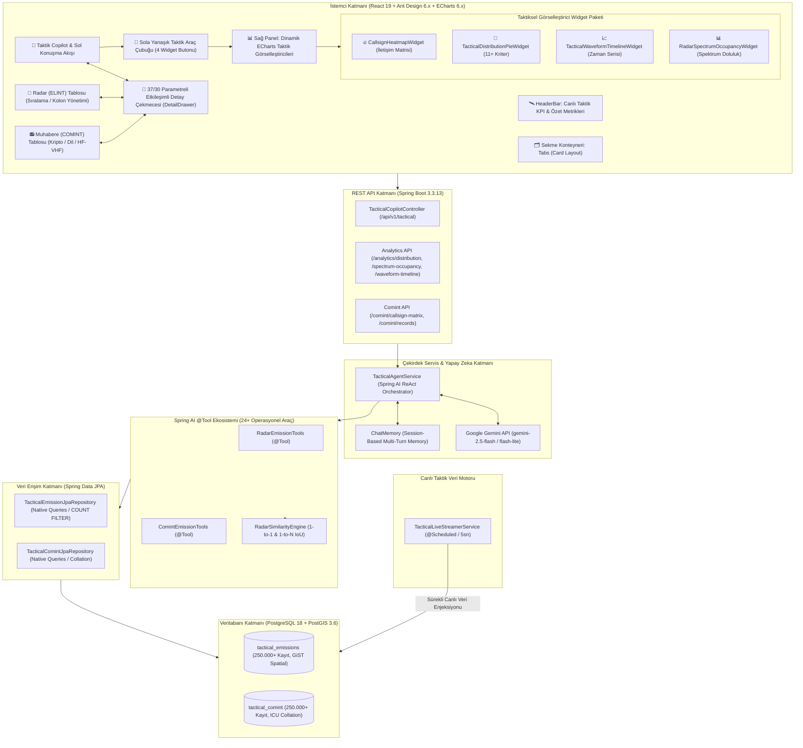

# Taktik Elektronik Harp (C2 EW / SIGINT) Copilot Sistemi - Versiyon 3
## Kapsamlı Sistem Mimarisi, Kavramsal Doktrin ve Yazılım Dokümantasyonu

---

## 1. YÖNETİCİ ÖZETİ VE PROJE VİZYONU

**Proje Adı:** Tactical EW Copilot - NextGen SIGINT Decision Support & C2 Visualization System (`tactical-ew-copilot-3`)  
**Sürüm:** `3.0.0-RELEASE` (Üçüncü Nesil C2 Komuta Kontrol & Çoklu Görselleştirici Mimarisi)  
**Teknoloji Altyapısı:** Spring Boot 3.3.13, Java 21 (LTS), Spring AI 1.1.8, Google Gemini API, PostgreSQL 18 & PostGIS 3.6 (500.000+ Kalıcı Kayıt), React 19 + Ant Design 6.x + Apache ECharts 6.x  
**Operasyonel Alan:** Askeri Komuta Kontrol (C2), Elektronik Harp (EH / EW - Electronic Warfare), Sinyal İstihbaratı (SIGINT: ELINT & COMINT)

Bu doküman; sahadaki Elektronik Destek (ED / ES) ve Kestirim / Yön Bulma (DF - Direction Finding) algılayıcılarından toplanan 500.000'i aşkın taktik radar yayını (**ELINT**) ve telsiz muhabere emisyonunu (**COMINT**) gerçek zamanlı analiz eden, karar verici komutan ve harekât analistlerine hem **doğal dilde durumsal farkındalık** hem de **etkileşimli taktik görselleştirme (ısı haritası, spektrum doluluk, dalga formu, dağılım grafikleri)** sunan **Taktik Elektronik Harp Copilot Sistemi (V3)**'nin tüm teknik ve kavramsal bileşenlerini detaylandırmaktadır.

### 1.1. Versiyon 1'den Versiyon 3'e Mimari Evrim

| Yetenek & Kriter | Versiyon 1 (Prototip) | Versiyon 2 (Temel Üretim) | Versiyon 3 (Güncel C2 ve Görselleştirme Mimarisi) |
| :--- | :--- | :--- | :--- |
| **Sinyal Kapsamı** | Yalnızca Radar (ELINT) odaklı | Radar (ELINT) + Telsiz (COMINT) | **Bütünleşik SIGINT & Çok Kaynaklı Mekânsal Füzyon** (ELINT + COMINT) |
| **Veri Katmanı & Boyutu** | In-Memory / Mock ~1.000 kayıt | PostgreSQL 16: 400.000+ kayıt | **PostgreSQL 18 + PostGIS 3.6:** 500.000+ kayıt, GiST mekânsal indeksler |
| **Kestirim & LOB Modeli** | Düzensiz LOB çizgileri | Çocuklu/Çocuksuz Elipsler, Bağlı/Başıboş LOB | **Tam Çift Yönlü Navigasyon:** Tıklanabilir LOB/Elips hiyerarşisi |
| **Arayüz (Frontend)** | Statik HTML5 / Basit CSS | Basit Web Formu | **React 19 + Ant Design 6.x + ECharts 6.x:** MIL-Dark C2 Operasyon Paneli |
| **Taktik Görselleştiriciler**| Yok | Yok | **5 Dinamik Widget:** Isı Haritası, Spektrum Doluluk, Dalga Formu, Dağılım, **Haftalık LOB Örümcek Ağı (Radar Chart)** |
| **Hedef Detay İnceleme** | Düz metin çıktısı | Basit modal | **37 & 30 Parametreli Etkileşimli Çekmece (DetailDrawer)** |
| **Benzerlik & Korelasyon** | Yok | Basit aralık filtresi | **1-to-1 IoU Karşılaştırma & 1-to-N 100 Puanlık Çok Kriterli Benzerlik** |
| **Doğal Dil & Ajan Yeteneği**| Basit genel özetler | Temel ReAct Araç Çağrısı | **25+ Özelleşmiş Spring AI @Tool, Deterministik Sistem Direktifi** |

---

## 2. KAVRAMSAL VE OPERASYONEL DOKTRİN (ANALİST BAKIŞ AÇISI)

Bu bölüm, sistemi kullanan askeri analistlerin, harekât subaylarının ve taktik karar vericilerin sahayı nasıl anlamlandırdığını açıklar.

### 2.1. Elektronik Harp (EH) ve SIGINT'in İki Ana Ayağı

Sistem, elektromanyetik spektrumu iki temel istihbarat disiplini altında işler:

```
                          ┌─────────────────────────────────────┐
                          │    SİNYAL İSTİHBARATI (SIGINT)      │
                          └──────────────────┬──────────────────┘
                                             │
                    ┌────────────────────────┴────────────────────────┐
                    ▼                                                 ▼
       ┌───────────────────────────┐                     ┌───────────────────────────┐
       │       ELINT (RADAR)       │                     │     COMINT (MUHABERE)     │
       │    Elektronik İstihbarat  │                     │    Haberleşme İstihbaratı │
       └────────────┬──────────────┘                     └─────────────┬─────────────┘
                    │                                                  │
         • Erken İhbar Radarları                              • Telsiz Ağları (HF, VHF)
         • Atış Kontrol Radarları                             • Sesli / Kriptolu Görüşmeler
         • Hava Savunma Sistemleri (HSS)                      • Darbe-Patlama (Burst) Yayınlar
         • Elektronik Taarruz (ET) Tespiti                    • Konuşma Trafiği (1'e 1, Çevrim)
```

1. **ELINT (Electronic Intelligence - Radar Emisyonları):**
   * Düşman, dost ve tarafsız hava savunma bataryaları, gemi radarları ve savaş uçağı radarlarının parametrelerini inceler.
   * RF Frekansı (MHz), Darbe Tekrarlama Aralığı (PRI), Darbe Genişliği (PW), Darbe İçi Modülasyon (MOP), Tarama Periyodu (ATP) ve Radar Görev Tipi (Arama, Takip, Atış Kontrol, Füze Güdüm).
   * Düşmanın aktif Elektronik Taarruz (ET / Karıştırma) yapıp yapmadığı ve taciz durumu anlık olarak izlenir.

2. **COMINT (Communications Intelligence - Telsiz Muhabere Emisyonları):**
   * Taktik sahada düşman unsurların kendi aralarında veya komuta merkezleriyle kurdukları haberleşmeyi takip eder.
   * Frekans bantları (HF: Stratejik uzun menzil / VHF: Taktik yakın birlik), çağrı adları (Call Signs), hedef çağrı adları, haberleşme protokolleri (DMR, TETRA, APCO25, D-Star, HF SSB).
   * Lisan analizi (Rusça, Arapça, Yunanca, İngilizce, Türkçe) ve haberleşme şekilleri (Ses, Kriptolu, Darbe Patlama / Frequency Hopping / Burst).

---

### 2.2. Kestirim Elipsi ve LOB Hiyerarşi Doktrini

Sistemin en yenilikçi analitik yeteneklerinden biri, ham algılayıcı yön bulma çizgileri (**LOB - Line of Bearing**) ile coğrafi hedef kestirimleri (**Kestirim Elipsi**) arasındaki yapısal ve zamansal bağı modellemesidir.

```
                  ┌────────────────────────────────────────────────────────┐
                  │              ELEKTROMANYETİK EMİSYONLAR                │
                  └───────────┬────────────────────────────────┬───────────┘
                              │                                │
                              ▼                                ▼
              ┌───────────────────────────────┐  ┌───────────────────────────────┐
              │   KESTİRİM ELİPSLERİ (HEDEF)  │  │     HAM LOB'LAR (KERTERİZ)    │
              └───────┬───────────────┬───────┘  └───────┬───────────────┬───────┘
                      │               │                  │               │
                      ▼               ▼                  ▼               ▼
              ┌──────────────┐ ┌──────────────┐  ┌──────────────┐ ┌──────────────┐
              │   ÇOCUKLU    │ │   ÇOCUKSUZ   │  │    BAĞLI     │ │   BAŞIBOŞ    │
              │    ELİPS     │ │    ELİPS     │  │     LOB      │ │     LOB      │
              │(Çoklu Sensör)│ │ (Doğrudan)   │  │(Füzyona Giren│ │(Kör Nokta /  │
              │              │ │ (Veri Bağı)  │  │   Kerteriz)  │ │ Erken İhbar) │
              └──────────────┘ └──────────────┘  └──────────────┘ └──────────────┘
```

#### A. Kestirim Elipsleri (Hedef Koordinat Belirsizlik Alanları)
* **Çocuklu Kestirimler (Çoklu İstasyon / LOB Füzyonlu):**
  * Sahadaki 2 veya daha fazla yerel elektronik harp unsuru (KORAL, REDET, DF Dinleme Postaları) tarafından aynı anda kerteriz alınmış (AOA - Angle of Arrival) ve kesişim matematiksel füzyonla hesaplanmış hedeflerdir.
  * Bu kayıtların veritabanında `kestirim_id = parent_id` ilişkisiyle bağlı en az 2-3 adet ham LOB'u ("çocuğu") bulunur.
  * Güvenilirlik katsayısı en yüksek hedeflerdir.
* **Çocuksuz Kestirimler (Ham LOB Kayıtsız / Doğrudan veya Harici Kestirimler):**
  * Veritabanında bağlı herhangi bir yerel ham LOB kaydı bulunmayan kestirimlerdir.
  * **Askeri Gerçeklik:** Tüm çocuksuz kestirimler peşinen tek bir kaynağa (örneğin sadece Link-16'ya) indirgenemez. Çocuksuz bir kestirim sahada şu kanallardan intikal edebilir:
    1. *Taktik Veri Ağları (Link-16 J3.2/J3.5, Link-11, Link-22, JREAP)*
    2. *Hava/İHA Platform İntikalleri (AWACS HİK, ANKA/Bayraktar ELINT Podu)*
    3. *Doğrudan TDOA / FDOA Kestirim Sistemleri (AOA kerteriz çizgisi üretmeyen, varış zaman farkıyla doğrudan koordinat bulan algoritmalar)*
    4. *Manuel Operatör / İstihbarat Girişleri*
    5. *Ham LOB'ları saklamayan miras (legacy) veya uzak birlik aktarımları.*

#### B. Ham LOB'lar (Line of Bearing - Tekil Kerteriz Hatları)
* **Bağlı LOB (Associated LOB):**
  * `kestirim_id` alanı doludur. Bir kestirim elipsine dahil olmuş, o kestirimin hesaplanmasına katkı sunmuş yön çizgisidir.
* **Başıboş LOB (Unassociated / Stray LOB):**
  * `kestirim_id` alanı `null`'dır. Sahadaki tek bir sensör tarafından tespit edilmiş ancak ikinci veya üçüncü bir istasyon tarafından duyulamadığı için kerteriz kesişimi yapılamamış tekil yön çizgileridir.
  * **Operasyonel Anlamı:** Düşmanın çok kısa süreli yayın yapıp sustuğu (Radar burst / Telsiz fısıltı yayını), coğrafi kör noktalarda kaldığı veya tekil erken ihbar alarmı ürettiği kritik temas hatlarıdır.

---

### 2.3. Zaman Kısıtlı Hareketlenme ve Trafik Analizi

Statik veritabanları operatörü yanıltır. Taktik karar verici için önemli olan *"Düşman son 1 saatte ne yaptı?"* veya *"Son 24 saatte telsiz konuşma yoğunluğu nereye kaydı?"* sorusudur.

Sistem şu zaman pencerelerini tam dinamik olarak destekler:
* **`SON_1_SAAT`:** Anlık taktik temas, acil tehditler, yeni beliren radar ve muhabere kaynakları.
* **`SON_24_SAAT`:** Günlük operasyonel niyet analizi, nöbet değişimleri, radar açma-kapama disiplini.
* **`BUGUN`:** İçinde bulunulan takvim gününün sıfır saatinden itibaren oluşan harekât resmi.
* **`SON_7_GUN` / `TUM_ZAMANLAR`:** Stratejik konuşlanma ve uzun dönemli frekans kullanım haritası.

---

### 2.4. İkili ve Tekli Muhabere Trafik Analizi

Telsiz muhaberesinde yalnızca içeriğe değil, **trafiğin kimler arasında aktığına** odaklanılır:
* **İkili Konuşmalar (Noktadan Noktaya / 1'e 1):** Belirli iki çağrı adı arasındaki gizli/taktik emir-komuta akışları (Örn: `OMAR-11` ↔ `EAGLE-LEAD`, `VOLGA-01` ↔ `VOLGA-04`).
* **Tekli / Çevrim Yayınları (Broadcast):** Bir komuta merkezinin sahaya yaptığı genel duyurular, taktik yönlendirmeler veya çağrısına yanıt alamayan tekil telsizler.
* **Kripto ve Lisan Dağılımı:** Kriptolu yayın oranının ani yükselişi operasyonel bir taarruz hazırlığının, darbe-patlama (burst) yayınları ise elektronik harbe karşı frekans atlamalı telsiz kullanımının göstergesidir.

---

## 3. YAZILIM MİMARİSİ VE TEKNİK TASARIM (YAZILIMCI BAKIŞ AÇISI)

Bu bölüm, sistemi geliştiren, genişleten ve bakımını yapan yazılım mühendisleri için mimari detayları içerir.

### 3.1. Uçtan Uca Sistem Mimarisi (Mermaid)



---

### 3.2. Teknoloji Yığını ve Kütüphaneler

* **Java Sürümü:** Java 21 (LTS) - Records, Sealed Types, Pattern Matching for switch/instanceof.
* **Çatı (Framework):** Spring Boot 3.3.13 (`spring-boot-starter-web`, `spring-boot-starter-data-jpa`, `spring-boot-starter-validation`).
* **Yapay Zekâ Entegrasyonu:** Spring AI 1.1.8 (`spring-ai-starter-model-google-genai`).
* **LLM Sağlayıcı:** Google Gemini API (`gemini-2.5-flash` / `gemini-1.5-flash`).
* **Veritabanı:** PostgreSQL 18 + PostGIS 3.6 (GiST spatial indeksleme, ICU Türkçe Collation, HikariCP).
* **Zamanlayıcı:** Spring Framework Task Scheduling (`@EnableScheduling`).
* **Önyüz Teknolojileri:**
  * **React 19:** Modern fonksiyonel bileşenler, ref callback'leri, transition hooks.
  * **Ant Design 6.x:** Askeri Koyu Tema (`#080d1a`, `#0f172a`, `#1e293b`), Drawer, Table, Segmented, Popover.
  * **Apache ECharts 6.x:** Isı haritası (Cartesian heatmap), pasta/donut/rose dağılımları, çok eksenli dalga formu zarfları, yığılmış çubuk (stacked bar) spektrum grafikleri.
  * **Marked.js:** Taktik brifing çıktılarında interaktif etiketli Markdown render motoru.

---

### 3.3. Spring AI Function Calling & `@Tool` Mimarisi (24+ Araç)

LLM'in halüsinasyon görmesini engellemek için **Function Calling (Araç Çağrısı)** mimarisi uygulanmıştır. LLM doğrudan veritabanına bağlanmaz; sistem tarafından denetlenen tip güvenli Java metotlarını çalıştırır:

#### 1. Radar Araçları ([RadarEmissionTools.java](file:///c:/Users/Aselsan/Desktop/EWSpringAI_v1/springAIDeneme3/src/main/java/com/c2/ew/agent/tools/RadarEmissionTools.java))
* `getTacticalMacroStats()`: Genel radar makro metrikleri (toplam emisyon, düşman/dost/tarafsız, ET durumu).
* `analyzeRadarHierarchy(String zaman, String kategori, String durum, Integer limit)`: 
  * Zaman kısıtlı (`SON_1_SAAT`, `SON_24_SAAT`, `BUGUN`) elips ve LOB hiyerarşisi.
  * Çocuklu vs Çocuksuz elips sayıları, oranları, ortalama LOB sayıları.
  * Bağlı vs Başıboş LOB sayıları, oranları ve coğrafi/frekans detay listesi.
* `queryPriorityThreats(Integer limit)`: En öncelikli düşman atış kontrol ve arama radarları.
* `getRadarSpectrumOccupancy(String timeRange, String teshisKimlik)`: 50/100/200 MHz sabit frekans aralıklarında spektrum doluluk ve kullanım yoğunluğu (Union-based) analizi.
* `getTacticalDistribution(String source, String criterion, String timeRange, Integer limit)`: Radar veya telsiz kategorik özelliklerinin pasta/halka/gül grafik dağılımı.
* `getWaveformTimeline(String source, String targetKey, String timeRange, Integer limit)`: Radar Spot No veya Telsiz Çağrı Adı için frekans, PRI, PW ve sinyal gücünün zamansal değişim trendi.
* `compareRadarEmissions(String id1, String id2)`: İki radar emisyonunu 1D IoU formülleriyle zaman, frekans, PRI, PW ve ATP bazında bire bir kıyaslar.
* `findSimilarRadarEmissions(String targetId, String timeRange, Integer limit)`: 100 puanlık çok kriterli matrisle sahada en çok benzeyen ilk N radar kaydını (Top-K) getirir.
* `getCrossDomainCorrelations(Double maxDistanceKm, Integer limit)`: Radar ve Muhabere hata elipslerinin CEP geometrik örtüşmesi ve Mahalanobis füzyonu.
* `getElectronicAttackReport()`, `analyzeRadarWaveformAgility()`, `getElectronicOrderOfBattleSummary()`, vb.

#### 2. Muhabere Araçları ([ComintEmissionTools.java](file:///c:/Users/Aselsan/Desktop/EWSpringAI_v1/springAIDeneme3/src/main/java/com/c2/ew/agent/tools/ComintEmissionTools.java))
* `getComintMacroStats()`: Genel muhabere istatistikleri (HF/VHF, dil dağılımı, haberleşme şekilleri).
* `analyzeComintHierarchy(String zaman, String kategori, String durum, Integer limit)`:
  * Zaman kısıtlı telsiz elipsi ve telsiz LOB'u hiyerarşisi.
  * Başıboş telsiz LOB'ları (tekil dinleme karakolu kayıtları).
* `getCallsignPairInteractionStats(String zaman, Integer limit)`: Telsiz çağrı adı ikililerini (Link Pairs), konuşma/temas sayılarını ve toplam konuşma süresini döner (Isı Haritası motoru).
* `getMostActiveCallsigns(String zaman, Integer limit)`: En aktif telsiz çağrı adlarının sıralaması.
* `queryComintCallsignNetwork(String cagriAdi, String karsiCagriAdi, String zaman)`: İki istasyon arasındaki karşılıklı link haritası ve tüm frekans geçmişi.
* `getComintTrafficTrend(String zaman, Integer surgeThresholdMultiplier)`: Saatlik hareketlenme ve trafik patlaması (Surge / Spike) analizi.
* `queryPriorityComintThreats(Integer limit)`: Kriptolu ve darbe-patlama düşman muhabere ağları.
* `getComsecAndTransmissionTactics()`: Kripto, darbe-patlama, karıştırma ve hareketli telsiz (MTI) raporu.
* `getComintEmissionDetails(String comintId)`: Tekil bir muhabere kaydının 30 parametresinin tamamı.

#### 3. Araç İcra Takip ve Günlükleme (ThreadLocal Logging)
Her araç icrası, `ThreadLocal<List<String>> CALL_LOGS` üzerinden kaydedilir. Bu sayede REST yanıtındaki `executionLogs` dizisinde operatöre *"Yapay zeka hangi Java araçlarını çalıştırdı?"* şeffaf olarak gösterilir.

---

### 3.4. Taktik Görselleştirme ve Komuta Kontrol Arayüz Mimarisi (V3)

Sistemin V3 sürümünde önyüz, karar vericinin tek ekranda hem sohbet edebileceği hem de bağlamsal grafik panellerini inceleyebileceği **bölünmüş panel (Split-Screen) ve tam ekran modal** mimarisine kavuşturulmuştur:

1. **Sola Yanaşık Taktik Araç Çubuğu:**
   * Operatörün tek tıkla sağ paneli açıp kapatabilmesi için **4 ana taktik görselleştirici butonu** en sola yanaşık olarak konumlandırılmıştır:
     - `🔥 Isı Haritası`: COMINT Çağrı Adı İletişim Matrisi
     - `🥧 Dağılım Grafiği`: ELINT/COMINT 11+ Kriter Pasta/Halka Dağılımı
     - `📈 Dalga Formu`: Zamansal RF & Darbe Parametreleri Değişimi
     - `📊 Spektrum Doluluk`: 50/100/200 MHz Sabit Aralıklar ve Çoklu Teşhis Analizi
   * Araç butonlarının hemen sağında ayraç ve hızlı eylem butonları (`📡 Genel Taktik Durumu Özetle`) yer alır.

2. **Telsiz İletişim Isı Haritası (`CallsignHeatmapWidget.jsx`):**
   * Kaynak çağrı adları (Y Ekseni) ile Hedef çağrı adları (X Ekseni) arasındaki çapraz etkileşim matrisidir.
   * **İki Farklı Skala:** Aşırı değer sapmalarını engelleyen 5 dilimli akıllı kademe (`PIECEWISE` Quintile) veya doğrusal termal spektrum (`CONTINUOUS`).
   * Hücrelerin üzerine gelindiğinde toplam görüşme adedi, süre, VHF/HF oranları ve kripto baskınlığı zengin tooltip ile sunulur.

3. **Taktik Dağılım Analizi (`TacticalDistributionPieWidget.jsx`):**
   * Radar Spot No, Teşhis, Görev, Polarizasyon, Modülasyon, Platform, Bölge, Çağrı Adı, Lisan ve Bant kriterlerine göre anlık pasta dağılımı.
   * `Pasta`, `Halka (Donut)` ve `Gül (Nightingale Rose)` görsel modları; tıklanabilir dinamik lejant ve dış etiketler.

4. **Taktik Dalga Formu & Zamansal Değişim Çizelgesi (`TacticalWaveformTimelineWidget.jsx`):**
   * Üst grafikte Frekans (MHz), PRI ($\mu s$) veya PW ($\mu s$) minimum/maksimum zarf bandı (Envelope Area) ve merkez çizgi trendi.
   * Alt grafikte senkronize darbe sinyal gücü (Genlik - dBm) çubukları ve kaydırılabilir `DataZoom` zaman penceresi.

5. **Radar Spektrum Doluluk Analizi (`RadarSpectrumOccupancyWidget.jsx`):**
   * Sabit frekans dilimlerinde (50 MHz, 100 MHz, 200 MHz) radar yayınlarının örtüşme alanlarını (Union) hesaplayarak spektrumun ne kadarının işgal edildiğini raporlar.
   * Düşman, Dost, Tarafsız ve Bilinmeyen unsurların spektrum payını yığılmış çubuk grafiği (Stacked Bar) ve sıralanabilir taktik tablo ile görselleştirir.

6. **37 & 30 Parametreli Hedef Detay Çekmecesi (`DetailDrawer.jsx`):**
   * Radar için 37, Muhabere için 30 teknik parametre (RF, PRI, PW, ATP, Anten Kutuplanması, Sensör Konumu, Kestirim Elipsi CEP, Operatör Notu, Onay Durumu).
   * **Çift Yönlü Doktrin Linkleri:** Kestirim incelenirken bağlı LOB'lara; LOB incelenirken bağlı olduğu kestirime doğrudan tıklanarak anında geçiş yapılabilir.

---

### 3.5. Sistem Direktifi ve LLM Orkestrasyonu

[`TacticalAgentService.java`](file:///c:/Users/Aselsan/Desktop/EWSpringAI_v1/springAIDeneme3/src/main/java/com/c2/ew/agent/service/TacticalAgentService.java) sınıfı, `ChatClient` ile Gemini API arasındaki köprüyü kurar.

**Deterministik Kural Tasarımı (`SYSTEM_DIRECTIVE`):**
1. **Askeri Doktrin:** Bilgi uydurmak yasaktır; tüm sayılar ve kimlikler araçlardan alınmalıdır.
2. **Kural 8 (SIGINT Hiyerarşi & LOB Direktifi):**
   * Çocuklu/Çocuksuz elipsler veya doğrudan kestirimler sorulduğunda `analyzeRadarHierarchy(..., "ELIPS", ...)` veya `analyzeComintHierarchy(..., "ELIPS", ...)` çağrılır.
   * Başıboş/Bağlı LOB'lar sorulduğunda `kategori="LOB"` ve `durum="BASIBOS"` parametreleriyle araçlar tetiklenir.
   * Peşin etiketleme yasağı: Çocuksuz kestirimler asla doğrudan "Link-16" olarak adlandırılmaz; kaydın kendi açıklamasında spesifik bir kaynak yoksa *"Çocuksuz Kestirim (Ham LOB Kayıtsız / Doğrudan Kestirim)"* denir.
3. **Kural 9 (Görselleştirici & Matris Tetikleme):**
   * Operatör spektrum doluluk sorduğunda `getRadarSpectrumOccupancy`; dalga formu trendi sorduğunda `getWaveformTimeline`; kategorik oranlar sorduğunda `getTacticalDistribution`; çağrı çifti etkileşimi sorduğunda `getCallsignPairInteractionStats` çalıştırılır.
4. **Zaman Uyarlaması:** Sorudaki zaman ifadeleri ("son 1 saat", "son 24 saat", "bugün") otomatik olarak standart zaman kodlarına (`SON_1_SAAT`, `SON_24_SAAT`, `BUGUN`) dönüştürülür.
5. **Hafıza (ChatMemory):** Her oturum için `conversationId` bazlı çok turlu konuşma geçmişi korunur.
6. **Direnç (Resilience):** Gemini API geçici ağ veya kota hatalarında (HTTP 429/503) 3 denemeli üstel geri çekilme (exponential backoff) devrededir.

---

## 4. VERİTABANI VE PERFORMANS MÜHENDİSLİĞİ (400.000+ KAYIT)

400.000'i aşkın taktik kaydın gerçek zamanlı filtrelenmesi ve saniyeler yerine milisaniyeler seviyesinde sorgulanması için özel optimizasyonlar uygulanmıştır.

### 4.1. Veritabanı Şeması ve İndeksleme

İki temel tablo bulunmaktadır: `tactical_emissions` (Radar) ve `tactical_comint` (Muhabere).

```sql
-- Kritik Alanlar ve İndeks Yapısı
CREATE INDEX idx_radar_tip_zaman ON tactical_emissions(kayit_tipi, son_tespit_zamani DESC);
CREATE INDEX idx_radar_kestirim_id ON tactical_emissions(kestirim_id);
CREATE INDEX idx_radar_teshis ON tactical_emissions(teshis_kimlik);

CREATE INDEX idx_comint_tip_zaman ON tactical_comint(kayit_tipi, son_tespit_zamani DESC);
CREATE INDEX idx_comint_kestirim_id ON tactical_comint(kestirim_id);
CREATE INDEX idx_comint_cagri ON tactical_comint(cagri_adi, karsi_cagri_adi);
```

### 4.2. Ultra Hızlı Native SQL Mimarisi: `COUNT(*) FILTER (...)`

Geleneksel birden fazla `COUNT` sorgusu atmak veya Java seviyesinde 400.000 kaydı belleğe çekip filtrelemek sistemi kilitler. Bunun yerine PostgreSQL'in tek geçişli (Single-Pass Scan) `FILTER` yeteneği kullanılmıştır:

```sql
-- 400.000 kayıt arasından Son 1 Saatin tüm makro hiyerarşisini 25-35 ms'de döner:
SELECT 
  COUNT(*) FILTER (WHERE kayit_tipi = 'KESTIRIM_ELIPS') as total_elips,
  COUNT(*) FILTER (WHERE kayit_tipi = 'KESTIRIM_ELIPS' AND EXISTS (
      SELECT 1 FROM tactical_emissions l WHERE l.kestirim_id = e.emission_id
  )) as childed_elips,
  COUNT(*) FILTER (WHERE kayit_tipi = 'KESTIRIM_ELIPS' AND NOT EXISTS (
      SELECT 1 FROM tactical_emissions l WHERE l.kestirim_id = e.emission_id
  )) as childless_elips,
  COUNT(*) FILTER (WHERE kayit_tipi = 'HAM_LOB') as total_lob,
  COUNT(*) FILTER (WHERE kayit_tipi = 'HAM_LOB' AND kestirim_id IS NOT NULL) as bagli_lob,
  COUNT(*) FILTER (WHERE kayit_tipi = 'HAM_LOB' AND kestirim_id IS NULL) as basibos_lob
FROM tactical_emissions e
WHERE e.son_tespit_zamani >= :baslangic AND e.son_tespit_zamani <= :bitis;
```

**Performans Ölçümü:**
* Eski usul Java içi filtreleme: ~4.500 ms (OOM riski)
* JPA Native `COUNT(*) FILTER`: **28 milisaniye!** ⚡

---

### 4.3. Dinamik Zaman Ayrıştırma Motoru (`parseTime`)

Her iki araç sınıfında yer alan `parseTime` metodu, doğal dil veya enum zaman parametrelerini hassas UTC `Instant` aralıklarına dönüştürür:

```java
private Instant parseTime(String zaman, boolean isStart) {
    Instant now = Instant.now();
    if ("SON_1_SAAT".equalsIgnoreCase(zaman)) {
        return isStart ? now.minus(Duration.ofHours(1)) : now;
    } else if ("SON_24_SAAT".equalsIgnoreCase(zaman)) {
        return isStart ? now.minus(Duration.ofHours(24)) : now;
    } else if ("BUGUN".equalsIgnoreCase(zaman)) {
        LocalDate bugun = LocalDate.now(ZoneId.of("Europe/Istanbul"));
        return isStart ? bugun.atStartOfDay(ZoneId.of("Europe/Istanbul")).toInstant() : now;
    }
    return null; // Tüm zamanlar
}
```

---

## 5. CANLI VERİ AKIŞ VE STRES SİMÜLATÖRÜ (`TacticalLiveStreamerService`)

Statik bir sistem sahayı temsil edemez. [`TacticalLiveStreamerService`](file:///c:/Users/onderproje/Desktop/AntigravitySpringAIDeneme3/src/main/java/com/c2/ew/infrastructure/streamer/TacticalLiveStreamerService.java), arka planda `@Scheduled(fixedRate = 5000)` anotasyonuyla her 5 saniyede bir otonom çalışan bir taktik akış simülatörüdür.

```
       ┌────────────────────────────────────────────────────────┐
       │   TacticalLiveStreamerService (5 Saniyelik Döngü)      │
       └───────────────────────────┬────────────────────────────┘
                                   │
         ┌─────────────────────────┴─────────────────────────┐
         ▼                                                   ▼
┌─────────────────────────────────┐         ┌─────────────────────────────────┐
│        RADAR AKIŞ ENJEKSİYONU   │         │       COMINT AKIŞ ENJEKSİYONU   │
├─────────────────────────────────┤         ├─────────────────────────────────┤
│ 1) 1 adet Çocuklu Elips         │         │ 1) 1 adet Çocuklu Elips         │
│    + 2 adet Bağlı LOB           │         │    + 2 adet Bağlı LOB           │
│ 2) 1 adet Çocuksuz Kestirim     │         │ 2) 1 adet Çocuksuz Kestirim     │
│    (İHA / TDOA / Link-16 İzi)   │         │    (AWACS / Karakol / TDOA İzi) │
│ 3) 1 adet Başıboş Ham LOB       │         │ 3) 1 adet Başıboş Ham LOB       │
│    (Tek İstasyon / Kör Nokta)   │         │    (Tek İstasyon / Kestirilemedi│
└─────────────────────────────────┘         └─────────────────────────────────┘
```

**Sağlanan Faydalar:**
1. **Canlı Taktik Dinamizm:** Operatör "Son 1 saat" analizi yaptığında, her dakika sisteme eklenen yeni hedefler sayesinde sayılar gerçek zamanlı olarak değişir ve hareketlenmeler yakalanır.
2. **Hiyerarşik Denge:** Sistemde hem çocuklu hem çocuksuz elipsler ile hem bağlı hem başıboş LOB'ların dengeli dağılımı korunur.
3. **Sürekli Stres Testi:** 400.000 kaydın üzerine her dakika +120 yeni kayıt eklenerek sistemin yüksek yük altında performans kaybı yaşamadığı garanti edilir.

---

## 6. REST API VE UÇ NOKTA REFERANSI

Sistem hem web önyüzü hem de harici C2 sistemleri için zengin REST servisleri sunar:

### 6.1. Taktik Karar Destek ve Ajan API'si
* **`POST /api/v1/tactical/analyze`**
  * **İstek Gövdesi:**
    ```json
    {
      "userPrompt": "Son 1 saatteki başıboş telsiz LOB'larını analiz eder misin?",
      "conversationId": "session-harekat-merkezi-01"
    }
    ```
  * **Yanıt:**
    ```json
    {
      "operationalBriefing": "## TAKTİK OPERASYONEL BRİFİNG\n### SON 1 SAATLİK MUHABERE...",
      "executionLogs": [
        "Tool Çağrısı: analyzeComintHierarchy(zaman=SON_1_SAAT, kategori=LOB, durum=BASIBOS, limit=15) çalıştırıldı."
      ]
    }
    ```

### 6.2. Taktik Analitik ve Görselleştirici API'leri (V3 Yeni)
* **`GET /api/v1/tactical/analytics/spectrum-occupancy`**
  * **Parametreler:** `timeRange` (`SON_1_SAAT`, `SON_24_SAAT`, `ALL`), `identities` (DUSMAN, DOST, TARAFSIZ, BILINMEYEN), `binStep` (50, 100, 200 MHz).
  * **İşlev:** Radar frekans spektrumundaki sabit aralıkların kullanım yoğunluğu ve örtüşme (Union) yüzdeleri.
* **`GET /api/v1/tactical/analytics/distribution`**
  * **Parametreler:** `source` (`RADAR`, `COMINT`), `criterion` (`TESHIS`, `GOREV`, `POLARIZASYON`, `CAGRI_ADI`, vb.), `timeRange`, `limit`.
  * **İşlev:** 11+ kategori bazında pasta, halka ve gül grafiği dilimleme verileri.
* **`GET /api/v1/tactical/analytics/waveform-timeline`**
  * **Parametreler:** `source`, `targetKey` (`SP048`, `VOLGA-01`), `timeRange`, `limit`.
  * **İşlev:** Hedefin frekans, PRI, PW zarf aralıkları ve sinyal gücü (dBm) zaman serisi.
* **`GET /api/v1/tactical/comint/callsign-matrix`**
  * **Parametreler:** `baslangicZamani`, `bitisZamani`, `limit`.
  * **İşlev:** Telsiz çağrı adı ikililerinin toplam temas sayısı, konuşma süreleri, VHF/HF ve kripto dağılım matrisi.
* **`GET /api/v1/tactical/analytics/weekday-radar`**
  * **Parametreler:** `source` (`TUMU`, `RADAR`, `COMINT`), `recordType` (`TUMU`, `SADECE_LOB`, `SADECE_KESTIRIM`), `timeRange` (`ALL`, `SON_7_GUN`, `SON_30_GUN`).
  * **İşlev:** PostgreSQL `EXTRACT(ISODOW FROM COALESCE(ilk_tespit_zamani, son_tespit_zamani))` ile Pazartesi-Pazar (1..7) günleri bazında hem Radar hem de Muhabere için tek geçişli koşullu toplamaları (`COUNT(*) FILTER (...)`) hesaplar; Apache ECharts 7 kollu örümcek ağı (radar) grafiğine zengin metrik veri seti sağlar.

### 6.3. Radar Tablo ve Detay API'leri
* **`GET /api/v1/tactical/emissions?page=0&size=15&sortField=minFrekansMhz&sortOrder=asc`**: Sayfalanmış ve sıralanmış radar tablosu.
* **`GET /api/v1/tactical/emissions/{id}`**: 37 parametreli tekil radar detay kartı ve bağlı LOB/elips ilişkileri.
* **`GET /api/v1/tactical/stats`**: Anlık canlı radar makro metrikleri.

### 6.4. Muhabere (COMINT) Tablo ve Detay API'leri
* **`GET /api/v1/tactical/comint?page=0&size=15`**: Sayfalanmış telsiz muhabere tablosu.
* **`GET /api/v1/tactical/comint/{id}`**: 30 parametreli tekil muhabere detay kartı.
* **`GET /api/v1/tactical/comint/stats`**: Anlık canlı muhabere makro metrikleri.

---

## 7. ANALİST KULLANIM SENARYOLARI VE ÖRNEK SORGULAR

Taktik operatör aşağıdaki doğal dil sorgularıyla sistemi tam kapasite yönetebilir:

### Senaryo 1: Hiyerarşik Radar Analizi (Çocuklu vs Çocuksuz)
> **Operatör Sorusu:** *"Son 1 saatteki çocuklu ve çocuksuz radar elipslerini analiz eder misin?"*  
> **Sistemin Yanıtı:** Çoklu istasyon füzyonlu (çocuklu) elips sayısı, ortalama LOB sayısı, doğrudan veya taktik veri ağlarından gelen çocuksuz kestirimler ve hata elipsi boyutlarını içeren detay tablosu.

### Senaryo 2: Başıboş Telsiz Kerterizleri (Kör Nokta Tespiti)
> **Operatör Sorusu:** *"Son 1 saatteki başıboş telsiz LOB'larını detaylarıyla listeler misin?"*  
> **Sistemin Yanıtı:** Herhangi bir kestirime dahil olmamış, tek istasyon tarafından yakalanmış acil veya tekil kerteriz hatlarının çağrı adları, frekansları, açıları ve dinleme postası konumları.

### Senaryo 3: İkili Muhabere Ağı ve Isı Haritası Analizi
> **Operatör Sorusu:** *"Son 24 saatte telsizde en çok kim kiminle konuştu? İkili konuşma trafiğini çıkar."*  
> **Sistemin Yanıtı:** En yoğun irtibat kuran istasyon çiftleri (Örn: `VOLGA-01` ↔ `VOLGA-04`), konuşma adedi, dili, haberleşme modu ve frekansı; sağ panelde otomatik olarak açılan Telsiz İletişim Isı Haritası.

### Senaryo 4: Radar Spektrum Doluluk & Sabit Bant Yoğunluğu
> **Operatör Sorusu:** *"Düşman radar yayınlarının sabit frekans aralıklarındaki spektrum doluluk ve kullanım yoğunluğunu analiz et."*  
> **Sistemin Yanıtı:** 50 MHz aralıklarla radar örtüşme oranları, düşman ve dost yayın yoğunlukları; sağ panelde otomatik açılan Spektrum Doluluk grafiği.

### Senaryo 5: Kritik Düşman Tehditleri ve Karıştırma
> **Operatör Sorusu:** *"Sahadaki aktif Elektronik Taarruz (ET) uygulanan veya taciz yapan düşman radarlarını özetle."*  
> **Sistemin Yanıtı:** Pantsir, S-400 veya Buk-M2 gibi atış kontrol radarlarının koordinatları, modülasyon tipleri ve karıştırma durumları.

### Senaryo 6: Haftalık LOB ve Kestirim Örümcek Ağı Analizi (Düşman Harekât Ritmi)
> **Operatör Sorusu:** *"Haftanın günlerine göre radar ya da muhabere kestirim/ LOB sayısını grafiğini ver."*  
> **Sistemin Yanıtı:** Pazartesi'den Pazar'a kadar olan günlerde tespit edilen radar ve muhabere yayınlarının LOB ve Kestirim ayrımıyla sayısal tablosu, askeri operasyonel niyet değerlendirmesi ve sağ panelde otomatik olarak açılan 7 kollu Apache ECharts Örümcek Ağı (Radar) Grafiği. Operatör bu widget üzerinde kaynak (Radar/Muhabere/Tümü), kayıt niteliği (Sadece LOB/Sadece Kestirim/Tümü) ve zaman penceresini dinamik olarak değiştirebilir.

---

## 8. GELECEK VİZYONU VE GELİŞTİRME YOL HARİTASI (V3.x & V4 İÇİN ÖNERİLER)

1. **3D Vektörel Taktik Harita Entegrasyonu:**
   * Kestirim elipsleri, sensör LOB hatları ve kapsama alanlarını gösteren WebGL/Cesium 3D veya OpenLayers harita bileşeni.
2. **Kestirim Menşei İçin Bağımsız Enum Parametresi:**
   * Çocuksuz kestirimlerin kaynaklarının serbest metin yerine yapısal `KestirimMensei` (`LINK16`, `IHA_INTIKAL`, `TDOA_DOGRUDAN`, `MANUEL`) kolonu ile indekslenmesi.
3. **Otomatik Füzyon Öneri Motoru (Smart Association Engine):**
   * Başıboş kalan LOB'ların frekans, zaman ve açı korelasyonuyla arka planda otomatik olarak mevcut elipslerle eşleştirilmesi için operatöre yapay zeka destekli öneri sunulması.
4. **Çoklu Ajan (Multi-Agent Swarm) Mimarisi:**
   * Radar Analisti Ajanı, Muhabere Analisti Ajanı ve Baş Harekât Subayı Ajanı olmak üzere özelleşmiş alt ajanların müzakere ederek ortak taktik resim oluşturması.

---
*Bu dokümantasyon, Tactical EW Copilot V3 projesinin tüm mimari, kavramsal ve kod bileşenlerini eksiksiz olarak yansıtmak üzere güncellenmiştir.*
